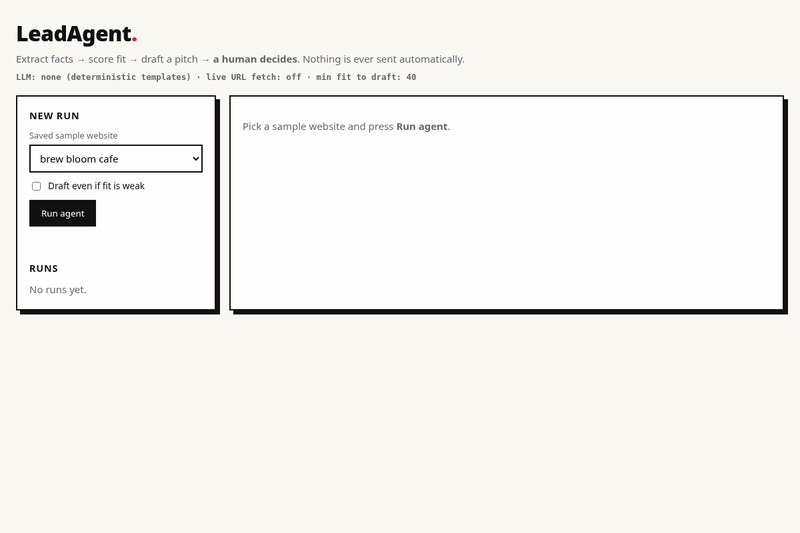
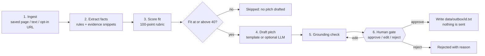
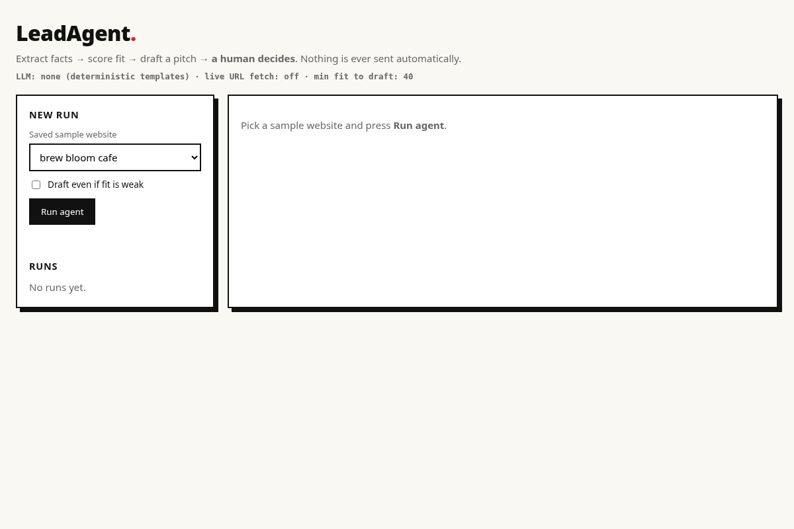
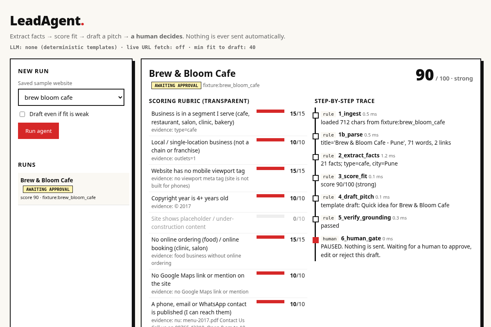
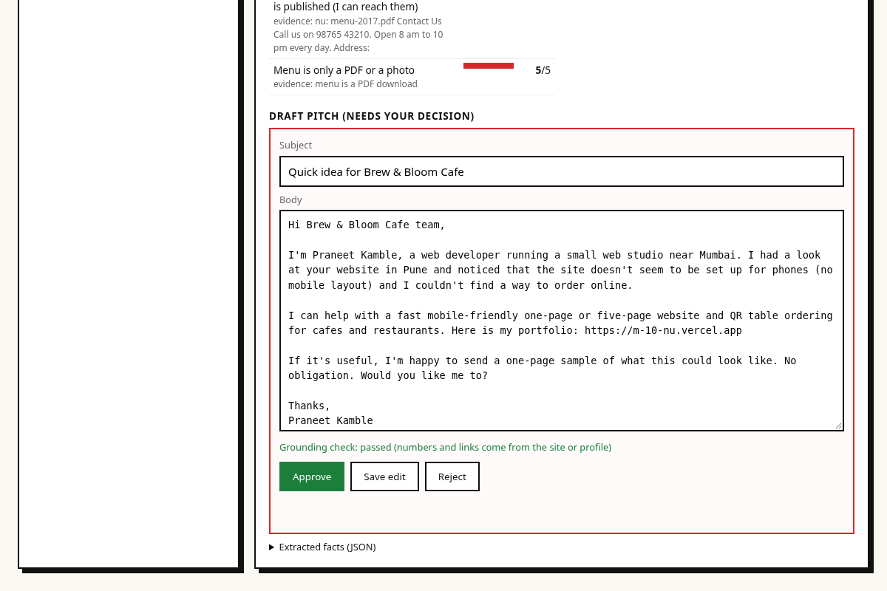
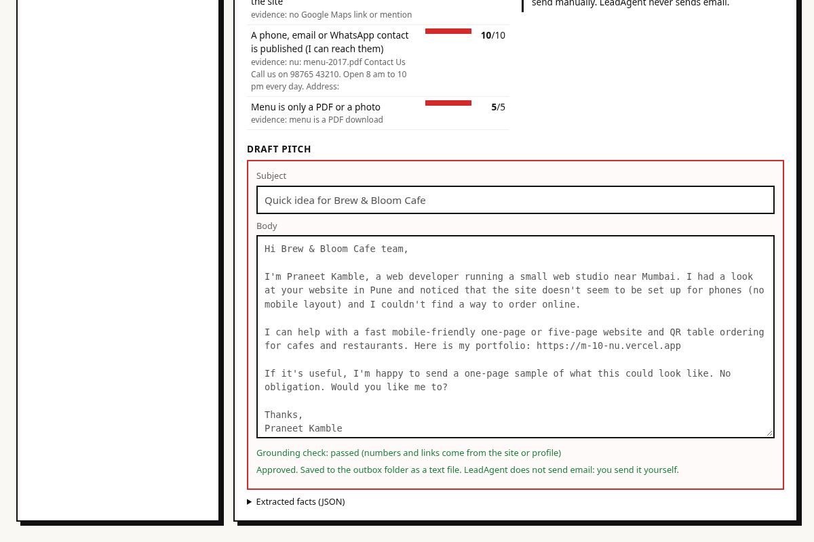
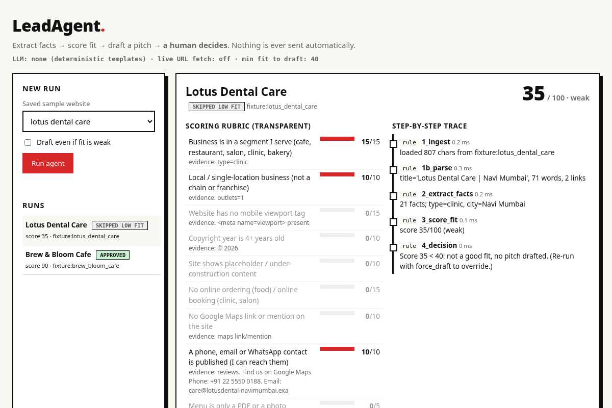

# LeadAgent

### A multi-step lead-qualification agent with a human approval gate


LeadAgent takes a business website (a saved sample page, pasted text or HTML, or an opt-in public URL) and runs a transparent pipeline: it extracts facts with evidence, scores the fit with a fixed rubric, drafts a pitch, verifies the draft against the source, and then **pauses for a person to approve, edit or reject it**. Every step is written to a trace log, and each run is persisted to disk, so the pause survives a restart.

**LeadAgent never sends anything.** "Approve" only saves the final text to `data/outbox/<id>.txt` for a person to send.



---

## ✨ Key features

- **Transparent pipeline.** Ingest, extract, score, draft, verify, then a human gate. Each step appears in a timeline with its mode (`rule` or `human`) and duration.
- **Evidence for every fact.** Each extracted fact keeps the snippet it came from, and the rubric shows the evidence next to every score line.
- **Traceable scoring.** A rule-based 100-point rubric with no LLM in the scoring path, so every point can be explained. Chains and franchises are capped at 20.
- **Grounding check.** Every number and URL in the draft must exist in the site text or the seller profile. Guarantee and urgency wording is flagged, and the draft must mention the business name. A draft that fails cannot be approved until it is edited.
- **Human decision.** Approve, edit (the edit is re-verified) or reject with a reason.
- **Durable runs.** Runs are stored as JSON files, and a paused run can be resumed after a restart.
- **Safe by default.** Live URL fetching is off unless `LEADAGENT_ALLOW_FETCH=1`, and only public http(s) hosts are allowed (private and loopback addresses are blocked).
- **Optional LLM drafting.** Any OpenAI-compatible endpoint can write the pitch. On any LLM error, the deterministic template is used instead.

---

## 🏗️ How it works



---

## 📷 Screenshots

### 1. Start screen


### 2. Run result: score, rubric with evidence, and step-by-step trace


### 3. Draft pitch waiting for a human decision


### 4. After approval: saved to the outbox, not sent


### 5. Weak fit: no pitch is drafted


All sites shown are fictional fixtures that ship with the repository.

---

## 🧩 Tech stack and what is actually used

| Step | Implementation |
|---|---|
| Ingest | stdlib HTML parser over 6 **fictional** saved websites in `fixtures/` (no scraping). Live URL fetch is **off** unless `LEADAGENT_ALLOW_FETCH=1`, only public http(s) hosts (private/loopback blocked) |
| Extract facts | **rule-based** (regex + keywords): business type, city, phone/email/WhatsApp, mobile viewport tag, copyright year, placeholder text, online ordering/booking, Google Maps link, menu as PDF/photo, chain/franchise… each fact keeps its evidence snippet |
| Score fit | **rule-based, 100-point rubric** (`leadagent/score.py`), no LLM so every point is traceable. Chains/franchises are capped at 20. Below 40 → no pitch is drafted (override with "Draft even if fit is weak") |
| Draft pitch | deterministic **template** by default. Optional LLM (`LEADAGENT_LLM_BASE_URL`, `LEADAGENT_LLM_MODEL`, `LEADAGENT_LLM_API_KEY`, any OpenAI-compatible endpoint); on any LLM error it falls back to the template |
| Verify | **grounding check**: every number and URL in the draft must exist in the site text / seller profile; flags guarantee/urgency wording; must mention the business name. A draft that fails cannot be approved until edited |
| Human gate | approve / edit (re-verified) / reject (with reason) |
| UI | FastAPI + plain JS dashboard: rubric bars with evidence, trace timeline, editable draft |

Seller details used in the pitch live in `profile.json` (name, portfolio link, services). **Edit it before real use.**
The LLM path is tested with a *mocked* endpoint only; I have not run it against a real model. The default (and everything measured here) is rule-based.

---

## 📊 Rubric results on the 6 fixtures (just the rubric's output, not an accuracy claim)

| Fixture (fictional) | Score | Tier | Why |
|---|---|---|---|
| sharma_sweets | 95 | strong | under-construction page, no mobile layout, © 2012, no ordering, no Maps |
| brew_bloom_cafe | 90 | strong | no mobile layout, © 2017, PDF menu, no ordering, no Maps |
| spice_route_kitchen | 75 | strong | mobile OK, but © 2021, menu is a photo, no online ordering, no Maps |
| glow_studio_salon | 60 | moderate | no online booking, no Maps |
| lotus_dental_care | 35 | weak (skipped) | modern site with booking, Maps and reviews |
| urbanbite_franchise | 20 | weak (skipped) | 64-outlet chain, capped |

---

## 📂 Project structure

```text
leadagent/
├── leadagent/
│   ├── api.py            # FastAPI routes
│   ├── pipeline.py       # run orchestration, trace and persistence
│   ├── ingest.py         # fixture / text / opt-in URL loading
│   ├── extract.py        # rule-based fact extraction with evidence
│   ├── score.py          # 100-point fit rubric
│   ├── pitch.py          # template drafting and grounding check
│   ├── llm.py            # optional OpenAI-compatible drafting
│   ├── cli.py            # command-line interface
│   └── config.py         # configuration from environment variables
├── dashboard/            # plain HTML/CSS/JS dashboard
├── fixtures/             # 6 fictional business websites
├── profile.json          # seller details used in the pitch
├── data/                 # persisted runs and outbox (git-ignored contents)
├── tests/                # pytest suite
├── docs/                 # screenshots and demo GIF
├── Dockerfile
├── requirements.txt
└── requirements-dev.txt
```

---

## 🚀 Getting started

```bash
python -m venv .venv && source .venv/bin/activate && pip install -r requirements.txt
uvicorn leadagent.api:app --port 8001        # dashboard at http://localhost:8001
python -m leadagent run brew_bloom_cafe       # or from the CLI
python -m leadagent decide <run-id> approve   # approve | reject --reason "..." | edit --body "..."
```

Seller details used in the pitch live in `profile.json`. **Edit it before real use.**

Docker: `docker build -t leadagent . && docker run -p 8001:8001 -v $PWD/data:/data leadagent` (Dockerfile written, **not built here: Docker isn't installed on my machine**).

---

## 🧪 Tests

```bash
pip install -r requirements-dev.txt && python -m pytest -q
```

The 19 tests cover extraction, the rubric, the pipeline trace, pause and restart, approve/edit/reject, grounding, the mocked LLM with fallback, URL safety and the API.

---

## ⚠️ Limitations

- The rubric weights are my own judgement, not learned from data; I have **no evidence** about reply or conversion rates.
- Extraction is regex-based and tuned to the 6 fixtures; real sites (JS-rendered, multi-page, other languages) will need more work.
- The template pitch is generic by design; an LLM may write better text but the grounding check is only a lightweight guard, not a fact-checker.
- Single user, no auth, JSON files for storage.

